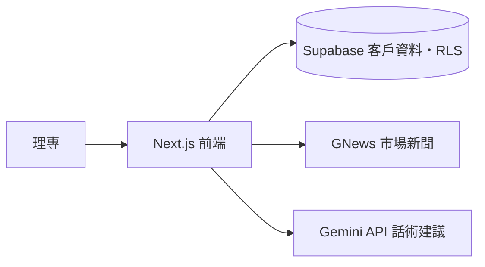

# 理專助理 AI｜AI Relationship Manager

> 把客戶資料與市場動態，變成理專可以直接說出口的話術。

🔗 **線上 Demo**：https://ai-relationship-manager-puce.vercel.app/
（Demo 帳號：`rm@bank.com`／密碼：`Demo2026!`，所有客戶資料皆為模擬資料）

## 為什麼做這個？

我曾在銀行擔任一年理財專員。第一線的理專每天要花大量時間：
- 查市場新聞，判斷哪些跟客戶持有的商品有關
- 翻閱客戶資料、持有部位與過去的通聯紀錄
- 想好「下一通電話該聊什麼」

這些準備工作重複又瑣碎，卻直接影響客戶關係的品質。這個專案就是把這個痛點做成工具。

## 功能

- **整合客戶全貌**：客戶資料、持有商品、歷史通聯紀錄集中在同一頁
- **連結市場動態**：串接 GNews 新聞 API，抓取與客戶持有部位相關的當日新聞
- **AI 產生聯繫話題**：透過 Gemini API 產生溝通建議與後續行動清單
- **追蹤提醒**：整合通聯紀錄與行事曆提醒
- **權限控管**：使用 Supabase Row Level Security，每位理專只能存取自己名下的客戶

## 截圖

<!-- 之後在這裡放 2～3 張截圖或 Demo GIF：登入頁、客戶總覽、AI 建議話術 -->

## 系統架構



## 技術

| 類別 | 技術 |
|---|---|
| 前端 | Next.js、React、TypeScript、Tailwind CSS |
| 資料庫與驗證 | Supabase（PostgreSQL、Auth、RLS） |
| AI | Google Gemini API |
| 外部資料 | GNews API |
| 部署 | Vercel |

## 本機執行

```bash
git clone https://github.com/Wu0510/AI-Relationship-Manager.git
cd AI-Relationship-Manager
npm install
npm run dev
```

在專案根目錄建立 `.env.local`，填入以下環境變數：

```
NEXT_PUBLIC_SUPABASE_URL=
NEXT_PUBLIC_SUPABASE_ANON_KEY=
GEMINI_API_KEY=
GEMINI_MODEL=
GNEWS_API_KEY=
```

資料庫結構與模擬資料在 `supabase/migrations` 與 `supabase/seed.sql`。

## 下一步

- [ ] 邀請現職理專試用，量化節省的準備時間
- [ ] 依客戶風險屬性（KYC）調整建議內容並加上合規提示
- [ ] 追蹤話術成效

## 作者

**吳柏逸**｜前永豐銀行理財專員，結合金融實務與數據／AI 應用
[Cake 履歷](https://www.cake.me/s--_QFUcGVF7J4qmaf_fWwIZQ--/ssett123)・[LinkedIn](https://www.linkedin.com/in/boy-wu-51018830b)
